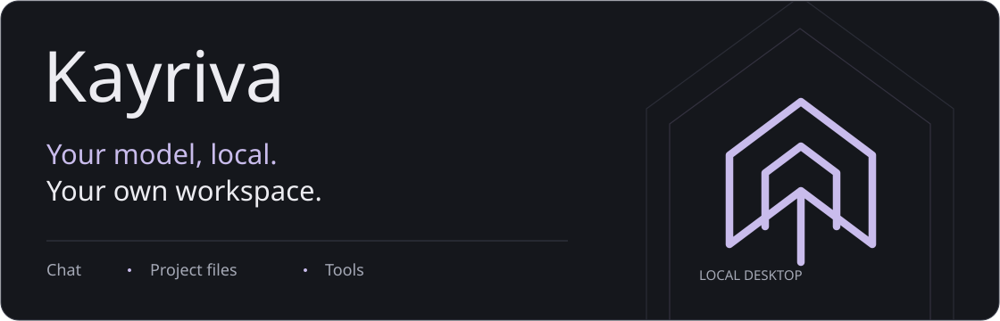
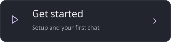
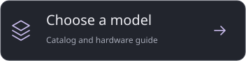
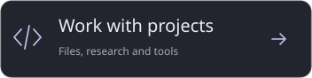
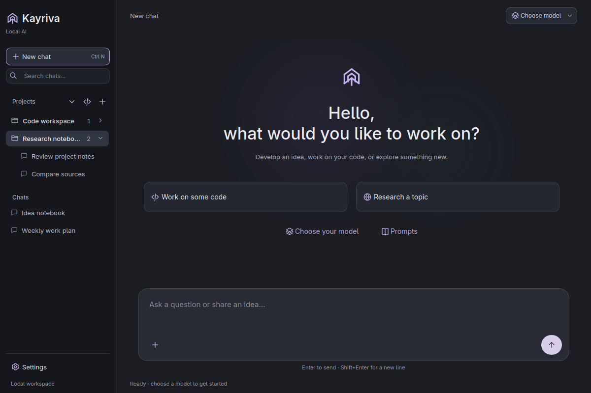
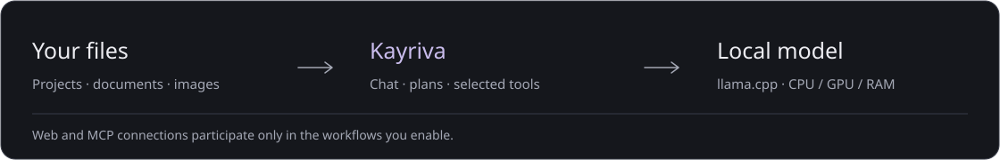

<p align="center">
  
</p>

# Kayriva

**A local AI workspace for conversations, projects and research.**

Bring your models and files together. Ask questions, explore sources, review code or turn an idea into a project document—all from one desktop application, with model inference running on your own computer.

**Linux · Windows · English · Türkçe**

<p>
  <a href="#get-started"></a>
  <a href="#find-your-model"></a>
  <a href="#work-with-your-projects"></a>
</p>

## Your workspace, at a glance



*The actual desktop interface, shown with example projects.*

## Work with your projects

Keep a conversation close to the files it belongs to. Move between everyday questions, focused coding work and research without losing your project context.

| Explore | What you can do |
| --- | --- |
| **Conversations** | Organize chats by project, search your history, pin conversations, reuse prompts and export replies as Markdown. |
| **Files and code** | Read and search project files, inspect specific lines, create documents and edit text with checks against unexpected changes. |
| **Research** | Choose a quick search or a broader investigation, compare sources and save the result to your project. |
| **Attachments** | Work with text, PDF and Office documents. Use a compatible vision model and matching projector to inspect images. |
| **Planning and tools** | Break work into steps, connect independent MCP tools and create assistant profiles for delegated tasks. |
| **GitHub** | Browse repositories, create one for a project and review selected files before uploading. |

Follow the progress of a task through its operation stages, elapsed time and sources. Copy or save a reply when it is ready, and stop generation from the same button used to send a message.

## Find your model

**141 variants · 71 model families · 18 brands**

Browse models by publisher, task, size and memory class. Compare quantizations on one card, download a model or add files you already have. Each catalog entry includes its source, license and file size.

Use **GPU + RAM** placement and adjustable memory budgets to find a comfortable fit for your computer. Choose whether to keep the model ready between messages or release its memory after a reply. View live generation speed and local usage charts over time.

Model compatibility and performance depend on your hardware and runtime. Larger models need more resources; available memory still sets the limit.

## Get started

1. **Open Kayriva.** On Windows, run `Kayriva-Setup.exe`. On Linux, extract the archive if needed, then make `Kayriva` executable and launch it:

   ```bash
   chmod +x Kayriva
   ./Kayriva
   ```

   On its first launch, the Linux app adds **Kayriva** to your applications menu.

2. **Choose a model.** Open **Settings → Models** to download one, or select **Add local model** to use your existing files.
3. **Prepare the runtime.** Under **Settings → General → Local runtime**, choose CPU, Vulkan or NVIDIA CUDA. Kayriva can install a missing runtime from the list.
4. **Start a conversation.** Select your model in the top bar. Add a project to work with its files, or begin with a simple message.

Model weights and runtime packages are downloaded separately from the application. The first model load can take longer than subsequent messages.

## Local by design

Your conversations, models and usage history are stored on your computer. **Model inference runs locally, with no application telemetry.** Web research, downloads, update checks and enabled integrations contact their respective services. Offline mode disables those connections.

Choose how operations are approved, adjust reply display and memory settings, and switch between English and Turkish. Application updates can be prepared in the background and applied when you choose to restart.

<p>
  
</p>

[Linux requirements](docs/linux-distribution.md) · [Model guide](docs/models.md) · [Tools and integrations](docs/integrations.md) · [Assistant profiles](docs/team.md) · [Build from source](docs/development.md)

*Model and integration guides are currently available in Turkish.*

Source-code license: not yet selected. Models, fonts and third-party components retain their respective licenses.
