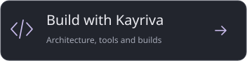

<p align="center">
  
</p>

# Kayriva

Chat with local models, work on project files, research sources and connect tools in one desktop workspace. **Kayriva** is a native Python and Qt application that manages its own **llama.cpp** runtime. No Ollama or LM Studio installation is required.

**1.0 Beta 1** · First public beta · Linux and Windows · English and Turkish

[Release notes](docs/releases/v1.0.0-beta.1.md) · [Türkçe sürüm notları](docs/releases/v1.0.0-beta.1.tr.md) · Tag: `v1.0.0-beta.1`

<p>
  <a href="#getting-started"></a>
  <a href="#model-library"></a>
  <a href="#development-and-builds"></a>
</p>

## From a conversation to a workspace

Research a topic and save a report to a project, review and edit code files, or simply talk to your local model. Real operation stages, sources and elapsed time stay visible alongside each reply. Kayriva does not expose a model's hidden chain of thought.

| What you want to do | What Kayriva provides |
| --- | --- |
| **Talk to a local model** | A searchable model picker, persistent conversations, pins, Markdown export and an editable prompt library. |
| **Work on a project** | Project conversations, file listing and reading, content search, line-range inspection, file creation and guarded text edits. |
| **Research sources** | Quick, Detailed and Long research modes, query diversification, sources from different sites, HTML/PDF text reading and a searchable source list. |
| **Inspect documents or images** | Text/code, PDF, DOCX, XLSX, PPTX and image attachments. Image understanding requires a compatible model and matching projector. |
| **Run a longer task** | Plan mode, a task checklist and configurable tool-round/time limits. Reaching a limit is not presented as successful completion. |
| **Connect your tools** | An MCP extension library for files, browsers, Git, document conversion and more; editable assistant profiles and delegated tasks. |
| **Publish a project to GitHub** | Use your existing CLI account to browse repositories, create a repository and preview/select the files to upload. |
| **Monitor local usage** | Live token speed, duration and hardware counters; daily/weekly/monthly history, charts and local error logs. |

### Desktop preview


*Actual application capture with example projects and local test data. This preview shows the default English interface with no model selected.*

<p>
  
</p>

## Getting started

### Run from source

Use **Python 3.11 or later**. From the project directory:

```bash
./kayriva.sh start
```

Missing Python dependencies can be installed into the project's `.venv`. Running `./kayriva.sh` without arguments opens one menu for launching, environment setup, Linux/Windows builds and tests. Kayriva opens as a desktop application, not a browser page.

### Prepare your first model

1. Open **Settings → Models** from the lower-left corner. Filter by hardware and task, choose a model and quantization, then download it.
2. Under **General → Local runtime**, select CPU, Vulkan or NVIDIA CUDA. Install a missing runtime from the list, or use **Choose file…** for a custom binary.
3. Start with **GPU + RAM / Automatic** memory placement. Select your downloaded model from the top bar and send a message.

Already have model files? **Add local model** accepts a file, a folder or a pasted path, including quoted paths, `file://` URLs and uppercase/lowercase GGUF extensions. Files remain in their original location. Split GGUF models require all parts in the same directory.

**The first load can take time.** General settings let you load on the first message, prepare the model at startup, or release memory after each reply. A larger model is not automatically faster or a better fit for your hardware.

## Model library

**141 variants · 71 model families · 18 brands.** The NVIDIA collection contains 32 variants across 12 families.

The catalog includes open-weight families from **NVIDIA, Qwen, DeepSeek, Google, Meta, Microsoft, Mistral, OpenAI, Hugging Face, Z.ai, IBM, Liquid AI, Cohere, Allen AI, OpenBMB, InternLM, 01.AI and ByteDance**. Filter by family, publisher, task, file size and capacity class. Quantizations share one model card with its source, license and actual file size.

- **Chat, code, reasoning, tools and vision** filters use catalog metadata. Web research and file operations come from Kayriva's tools, rather than giving every model native web access.
- **Low → Ultra** classes describe file-size ranges. They are not quality scores or measured speed rankings.
- **Refresh catalog** checks the filename, revision, size and SHA-256 without downloading model weights. Download URLs are resolved from the source instead of preserving temporary CDN links.
- Downloads show retries, resume support, speed, remaining time and checksum progress. An unavailable network does not erase the existing catalog.
- Models have separate licenses. Review the model card before use or redistribution.

**A catalog entry is not a guarantee of support in every runtime.** Architecture, quantization and vision support depend on the installed llama.cpp version. Vision models require a matching `mmproj`. The entire catalog has not been tested on physical GPUs.

[Verified catalog and sources](docs/model-catalog-research.md) · [Model and hardware guide](docs/models.md) · [Local/cloud AI research](docs/AI-RESEARCH-2026-11.md)

*The detailed guides linked here are currently in Turkish.*

## Manage memory and replies

General settings provide RAM and VRAM sliders for the model's usage budget. These are upper targets, not reservations: a smaller model does not have to consume the full amount. Sliders respect the detected device capacity and display total memory separately from currently free memory.

**GB and MB are decimal:** 1 GB = 1000 MB. Tooltips include the corresponding MiB/GiB values. Automatic mode leaves headroom for the system; a loaded model's own memory is not deducted again to shrink its load budget. The check considers weights, context and working buffers. It is not an operating-system-enforced memory quota.

| Setting | What it does |
| --- | --- |
| **Balanced / Low memory** | Low memory uses smaller batches, Q8 KV cache where compatible, and a smaller automatic starting context. It preserves an explicitly selected numeric context. |
| **Context: Unlimited · as needed** | Grows within the model and available memory limits. It does not mean unlimited physical memory; growth can require a reload. |
| **Reply limit: Unlimited** | Removes the user-configured output token cap. Runtime context and stopping conditions still apply. |
| **Reply display** | Show when complete, smooth blocks or live streaming. Complete mode reveals the finished answer at once, with no subsequent typewriter animation. |
| **Model preparation** | Load on first message, prepare at startup, or unload after each reply. |

Model size, GPU placement, context, memory bandwidth and runtime choice determine generation speed. Changing the way text appears does not accelerate a large model computing partly in RAM. See the [runtime setup guide](engine/README.md).

## Research, files and tools

The composer's **+** menu controls workspace tools, research modes and planning. Project outputs remain attached to the selected project. A request for one new file writes it to the project root; explicit subpaths are respected. Replacing an existing file verifies the hash of its previously read contents.

**Long research** defaults to targets of up to 18 queries, 200 sources and 60 page reads. Scope is configurable up to 48 queries / 400 sources / 160 pages. These are limits, not promised result counts: provider results, access and readability determine actual coverage. Read page text is distinguished from search snippets, and sources are not all dumped into the context. Long mode does not introduce an artificial minimum wait.

**Connections → Extension library** lists independent MCP servers with their capabilities and requirements. Installation is an explicit choice; added connections are disabled by default. Some require a separate Node.js/Python environment. ChatGPT-specific apps are not presented as transferable plugin packages.

The **GitHub** panel requires Git and [GitHub CLI](https://cli.github.com/) and uses the CLI's existing account session. Review repository visibility and selected files before creating/uploading. The project's `.gitignore` is honored; a selected snapshot is uploaded without changing the source project's Git history.

[Integration behavior and access scopes](docs/integrations.md) · [Delegated tasks](docs/team.md) · [MCP bridge](extensions/README.md)

## Language and application updates

The interface starts in **English**. Choose **English** or **Türkçe** in **Settings → General → Language**, save, then reopen the app. Switching language does not rewrite conversations, user prompts or model output.

**Settings → About & updates** shows the installed version, release notes and update status. Packaged builds check on startup and automatically download verified updates by default. You choose **Restart to update** when ready; an active task, unsent draft, attached file or unsaved edit prevents an interrupted restart. Source checkouts support manual checks but are not replaced by the updater. Offline mode disables update requests.

The configured release source is `sayrias/Kayriva`. It has not been published yet; until the first GitHub Release exists, the app reports that status without changing your installation. No repository or release is created by the build scripts.

Updates verify platform, architecture, size and SHA-256. When a matching previous artifact and a small enough block-delta exist, only the patch is transferred. Otherwise the app downloads the full verified package. Compressed single-file builds cannot guarantee small deltas for every release. Windows delta updates need a cached copy of the previous installer. Linux retains a previous executable with limited early-failure recovery. This verifies files from the trusted GitHub publisher; it is **not independent code signing**.

[Update architecture, release manifest and recovery](docs/update-system.md)

## Development and builds

**`kayriva.sh`** is the single management entry point. No separate `start.sh` is required.

```text
src/          Application source and tests
models/       Curated catalog; downloaded weights are not distributed
engine/       Local runtime setup and release manifest
extensions/   MCP extension catalog and sample configuration
docs/         Guides, design assets and release notes
kayriva.sh    Launch, test and package
```

```bash
./kayriva.sh setup             # Linux environment and packaging dependencies
./kayriva.sh start             # Run from source
./kayriva.sh build             # Build the Linux single-file application
./kayriva.sh run               # Launch the compiled Linux application
./kayriva.sh build-windows     # Build the Windows installer through Wine
./kayriva.sh run-windows       # Launch the Windows build through Wine
./kayriva.sh test              # Run tests
./kayriva.sh release           # Verify both builds and generate update assets
./kayriva.sh status            # Show environments and output paths
```

| Platform | Single file to distribute | Notes |
| --- | --- | --- |
| **Linux** | `dist/linux/Kayriva` | Includes Python/Qt and the MCP bridge. Requires compatible system libraries/ABI; rebuild on an older target distribution when necessary. |
| **Windows x64** | `dist/windows/Kayriva-Setup.exe` | Installs shortcuts and an uninstaller without requiring administrator privileges. |

Windows builds require **Wine, winepath and curl** on the build host. Initial setup installs official Python, pinned PySide6 and Inno Setup into the project's `build/wine-prefix`. A Qt DLL loading check runs before packaging. Build logs are stored in `build/linux/` and `build/windows/`. `clean` removes build output while preserving the prepared Wine environment.

The installer itself can run offline. **Model weights, local runtime packages and personal data are not included in the distribution.** Downloading models or preparing a runtime requires internet access; existing files can also be added manually. Optional Transformers dependencies are not included in the standard package.

### Verification scope

```bash
./kayriva.sh test
```

Tests cover chat/modal behavior, project boundaries, file-change checks, download verification/resume, memory budgets, image transport, MCP and GitHub previews. Some HTTP/model tests use simulated responses; they do not prove compatibility for every model or GPU. The Windows installer is checked under Wine, which does not replace inference testing on physical Windows hardware.

The optional Transformers text backend supports CPU/GPU/hybrid placement with additional dependencies and compatible weights. End-to-end inference with real Transformers weights has not yet been verified.

## Where your data lives

| Launch mode | User data |
| --- | --- |
| Source / `./kayriva.sh run` | Project-local `runtime/`, `models/` and runtime directories |
| Linux distribution | `$XDG_DATA_HOME/Kayriva` or `~/.local/share/Kayriva` |
| Windows distribution | `%LOCALAPPDATA%\Kayriva` |

Windows installs the application into `%LOCALAPPDATA%\Programs\Kayriva`. Updates and uninstallation preserve the separate user-data directory containing conversations and models. Disk data is not encrypted in this release.

Inference runs locally; the model server binds only to `127.0.0.1`. **There is no cloud inference or application telemetry.** Web queries go to the selected search provider, model downloads to Hugging Face, and runtime downloads to GitHub. Enabled MCP servers may have their own network behavior and file access. Offline mode blocks web, downloads, update checks and MCP processes. Automatic startup update checks also contact GitHub; they send no chat or project content.

Local error logs live under `runtime/logs/` inside the user-data root. Application logs do not record chat text, tool arguments or access keys; the runtime's own output has a separate log. Usage screens distinguish measured and estimated counters and keep history locally.

## Documentation

| Guide | Contents |
| --- | --- |
| [Architecture](docs/architecture.md) | Modules, runtime and data flow |
| [Design system](docs/design.md) | Colors, native components and interface decisions |
| [Model catalog](docs/model-catalog-research.md) | Verified files, official sources and runtime caveats |
| [AI research](docs/AI-RESEARCH-2026-11.md) | Local/cloud comparisons with sources |
| [Integrations](docs/integrations.md) | MCP setup, access scopes and GitHub behavior |
| [Application updates](docs/update-system.md) | GitHub checks, delta packages, release publishing and recovery |
| [Development plan](docs/ROADMAP-2026-11.md) | Scope, completed work and verification notes |

Kayriva is an original name combining an inspiration from Kayra with “-iva”; it is not presented as a historical mythological term. The banner and navigation artwork use the application's graphite/lavender palette and geometric emblem.

**License status:** A source-code license has not yet been selected. Until one is supplied, this repository should not be interpreted as granting an open-source license. Models, fonts and third-party components retain their respective terms; the Noto Sans SIL OFL text is included in the source.
